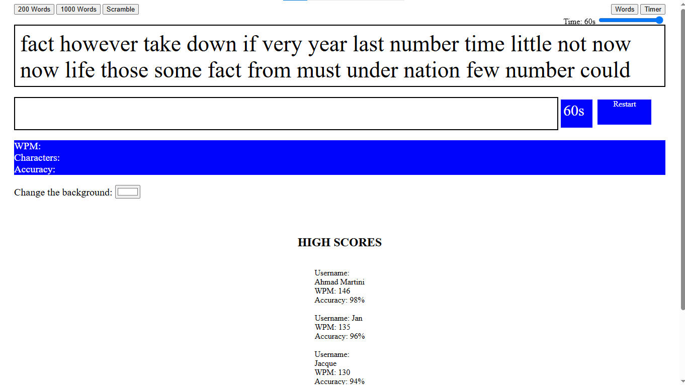
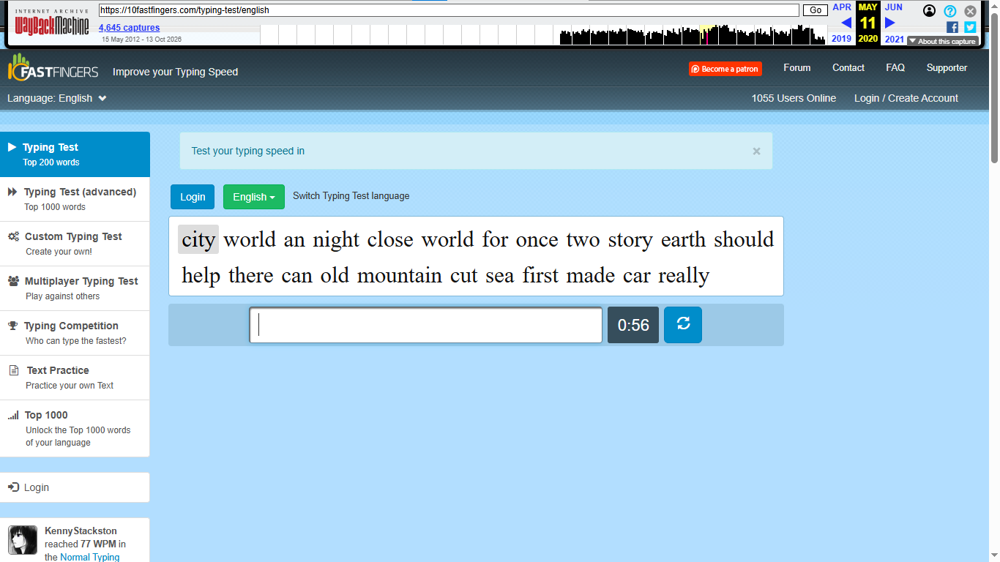

# Touch Typing Speed Test

### Description

This was considered one of my first projects. In college I was starting to really get into programming and where I starting to learn how to touch type since I was always around computers. I would go on different websites to then test how fast I am typing.

I picked out one of the websites I visited frequently and decided to recreate it from scratch. The page has now changed from when I first made the program so here is a picture to show what I was trying to go for.

Using a list of 200 of the most common english words I generate them at random for the display. Preventing the user from scrolling or selecting the text and ensuring the words get highlighted and scrolled into view. 

The user can then type into the text box allowing the test to begin. The aim is to then get all the words correct for it to be measured. At the end it gives you how many words you've typed in a minute also know as wpm. This is a measurement to determine how fast someone can type on a keyboard. Using a timer I can then count how many words they have gotten correct over this span and calculate the wpm.

There is also a list of 1000 common words which makes it slightly harder for the user as well as the scramble part. An adjustable timer allows for tests to be short or longer in length. 

A web server is used to store and manage a small text file for the leaderboard. Once you beat the score for the top 5 then it will prompt you for you name and will display your score for everyone. 

Was fun sending it to my friends to try beat me. Turns out they were better than me LOL

### Usage

Ensure that you have Node.js initialised on your computer. install socket.io.

npm install socket.io

Clone this repositiory into your own directory. Open a terminal at project directory

node index.js

will run the program. Keeping the terminal open will allow the program to run. In the browser go into the localhost at the port specified in the console.

localhost:3000

